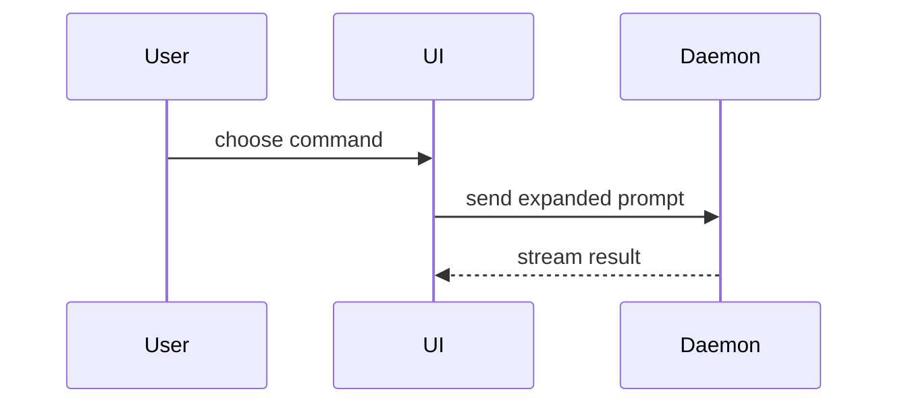

# Summary views

Pick the smallest view that makes the key point clear. Place each visual next to the short text it supports. Keep only the calls, files, props, states, and boundaries the reviewer needs. Use one view, sometimes several, rarely all.

## Logic or algorithm: pseudocode

```text
on(save)
  if content is unchanged
    return cached result
  write new content
  return fresh result
```

## Runtime control flow: call tree

```text
submitForm
  createSession
    persistPrompt
    launchAgent
  navigateToSession
```

## UI structure: component tree

Include the state and module boundaries that matter.

```text
<SessionPage> (apps/example/src/routes/session.tsx)
  useSessionEvents()
  <SessionToolbar>
    <RunSkillButton> (packages/ui)
```

## File responsibility or broad refactor: shallow file tree

```text
src/
├── commands/       # parses user actions
├── sessions/       # owns session state
└── transport/      # sends API requests
```

## Interaction, control flow, data flow: Mermaid



## What changes inside an existing shape: `diff`

Use when the surrounding shape already exists. Match the diff shape to the topic.

Component change:

```diff
 <SessionPage>
   useSessionEvents()
   <SessionToolbar>
+    <RunSkillButton />
   <SessionTimeline>
+    <SkillResultCard />
```

File-layout change:

```diff
 src/
 ├── commands/
+│   └── show-me.ts       # expands the slash command
 ├── sessions/
-└── transport.ts
+└── transport/
+    ├── client.ts
+    └── stream.ts
```

Call-tree change:

```diff
 submitForm
   createSession
     persistPrompt
+    expandSkillMention
     launchAgent
-  navigateToSession
+  navigateToSession
+    subscribeToEvents
```

State or control-flow change:

```diff
 on(save)
-  write content
+  if content is unchanged
+    return cached result
+  write new content
+  invalidate cache
```

## Mostly new code: the whole block

Use when most of it is new, when omitted context would hide ownership or order, or when the reviewer needs a copyable target shape.

```ts
function expandSkill(command: string): string {
  const skillName = command.slice(1);
  return `use the ${skillName} skill`;
}
```
